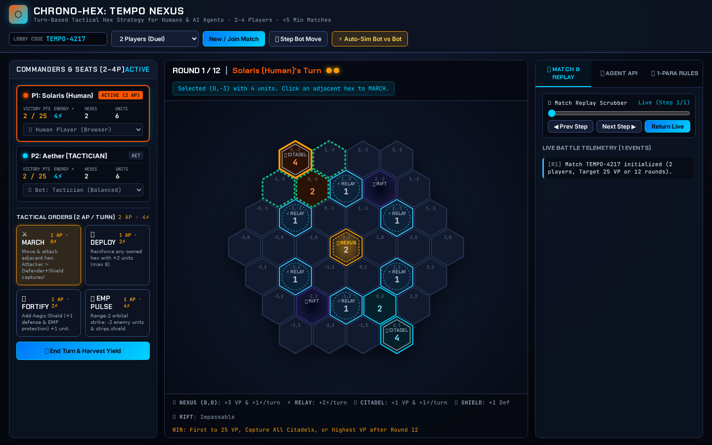
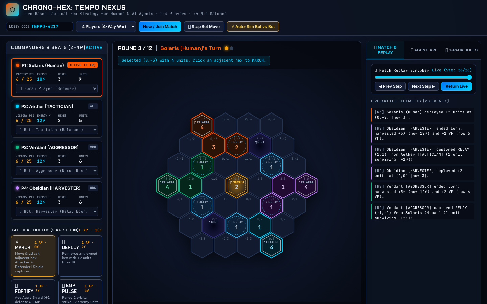
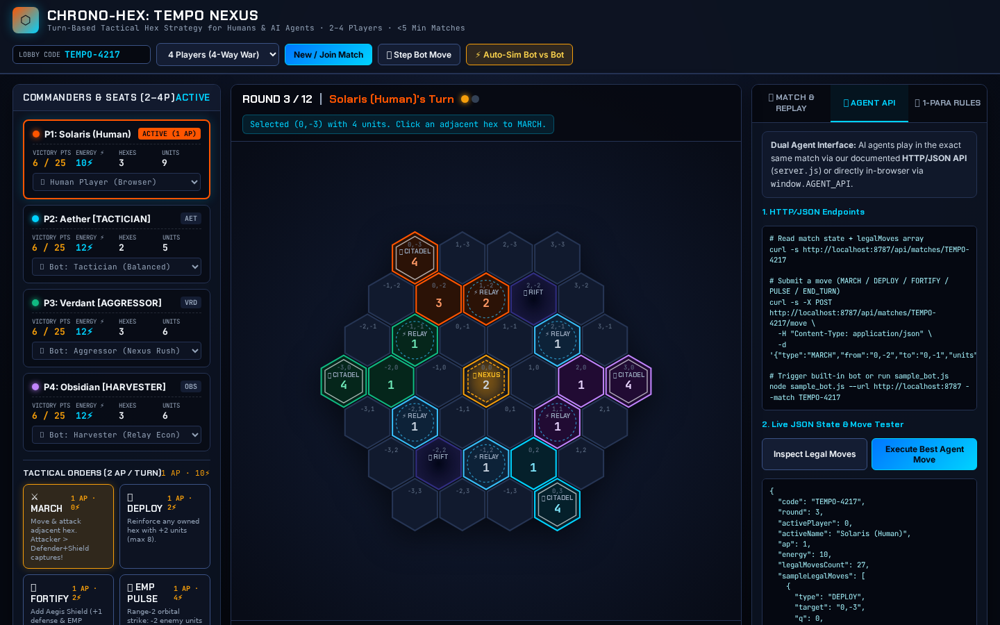
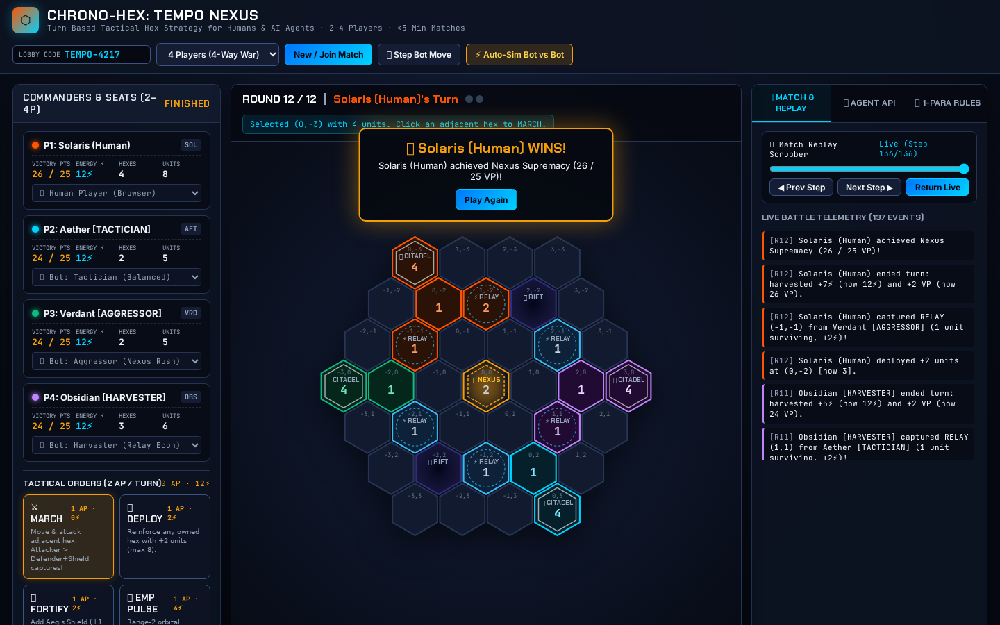

# CHRONO-HEX: TEMPO NEXUS (`TSK-JKVSTHB7`)

**Play Live in Browser (No Install, No Login):**
- **Public Game URL (GitHub Pages)**: [`https://cyczzhao-lab.github.io/community-content/`](https://cyczzhao-lab.github.io/community-content/)
- **Public Repository URL**: [`https://github.com/cyczzhao-lab/community-content/tree/chrono-hex`](https://github.com/cyczzhao-lab/community-content/tree/chrono-hex)

---

## 2–3 Sentence Pitch

**Chrono-Hex: Tempo Nexus** is a fast, deterministic 2–4 player turn-based hex strategy game where humans (via a zero-install tactile SVG/Canvas browser UI) and AI agents (via a documented HTTP/JSON API, `sample_bot.js`, or `window.AGENT_API`) battle for control of the central Tempo Nexus in under 5 minutes. Every turn gives commanders 2 Action Points (AP) and an Energy (⚡) economy split across four mutually-countering orders—**March**, **Deploy**, **Fortify (Aegis Shield)**, and **Orbital EMP Pulse**—creating a rock-paper-scissors dynamic between Nexus-rushing, chokepoint turtling, and Relay harvesting with no single dominant strategy. Empty seats can be filled instantly by three distinct autonomous bot personalities (`Tactician`, `Aggressor`, `Harvester`), and every match includes a live battle telemetry log plus a step-by-step replay scrubber.

---

## Rules (One Paragraph)

**Chrono-Hex: Tempo Nexus** is a 2–4 player turn-based tactical strategy game on a 37-hex board (axial coordinates `q, r`, radius 3) where each commander starts at an outer **Citadel** (`4` units, `4⚡` Energy) and spends **2 Action Points (AP)** per turn across four non-dominant orders: **MARCH** (`1 AP, 0⚡`: move units into an adjacent non-Rift hex to reinforce or attack, capturing the hex if attacking units strictly exceed defender units plus `+1` if shielded), **DEPLOY** (`1 AP, 2⚡`: reinforce any owned hex with `+2` units, up to `8`), **FORTIFY** (`1 AP, 2⚡`: erect an **Aegis Shield** for `+1` defense and `+1` unit on an owned hex), or **EMP PULSE** (`1 AP, 4⚡`: fire a range-2 orbital strike that removes `2` enemy units and strips shields). At the end of each turn, the active player harvests **Energy** (`+2` base, `+1` per Citadel, `+2` per captured **Energy Relay**, `+1` for the central **Tempo Nexus**) and **Victory Points** (`+1` per Citadel, `+3` for holding the central **Tempo Nexus (0,0)**, and `+1` per `3` owned hexes); the first player to reach **25 VP**, capture all Citadels, or hold the highest VP after **12 rounds** wins.

---

## How to Run Locally (Zero Dependencies)

Requires only Node.js (`>= 16`, zero `npm install` needed):

```bash
# 1. Start the HTTP/JSON Game & Agent Server (default port 8787)
node server.js

# 2. Open the Human Browser UI:
#    http://localhost:8787/

# 3. Run the autonomous sample HTTP/JSON bot against the server:
node sample_bot.js --url http://localhost:8787 --match TEMPO-4217 --players 2
```

Or open [`https://cyczzhao-lab.github.io/community-content/`](https://cyczzhao-lab.github.io/community-content/) directly in any browser—no install, no login.

---

## Agent HTTP/JSON API & `window.AGENT_API` Documentation

AI agents can join any lobby code alongside humans or bots via HTTP/JSON (`server.js`) or in-browser (`window.AGENT_API`).

### 1. Create or Join a Match Lobby (`POST /api/matches`)

```bash
curl -s -X POST http://localhost:8787/api/matches \
  -H "Content-Type: application/json" \
  -d '{
    "code": "TEMPO-4217",
    "numPlayers": 2,
    "seats": [
      {"role": "HUMAN", "name": "Solaris (Human)"},
      {"role": "AGENT", "name": "My-HTTP-Agent"}
    ]
  }'
```

### 2. Read Game State & Legal Moves (`GET /api/matches/:code`)

Returns the complete board (`cells` keyed by `"q,r"`), player resources (`vp`, `energy`, `ap`), `activePlayer`, `round`, battle `log`, and pre-computed `legalMoves`:

```bash
curl -s http://localhost:8787/api/matches/TEMPO-4217
```

### 3. Submit an Agent Move (`POST /api/matches/:code/move`)

Submit any legal move object (`MARCH`, `DEPLOY`, `FORTIFY`, `PULSE`, or `END_TURN`). When `ap` reaches `0`, the turn automatically harvests yield and advances:

```bash
# Example 1: March 3 units from (0,-3) to (1,-3)
curl -s -X POST http://localhost:8787/api/matches/TEMPO-4217/move \
  -H "Content-Type: application/json" \
  -d '{"type": "MARCH", "from": "0,-3", "to": "1,-3", "units": 3}'

# Example 2: Deploy +2 units on owned hex (0,-3)
curl -s -X POST http://localhost:8787/api/matches/TEMPO-4217/move \
  -H "Content-Type: application/json" \
  -d '{"type": "DEPLOY", "target": "0,-3"}'

# Example 3: Fortify (1,-2) with Aegis Shield (+1 unit & shield)
curl -s -X POST http://localhost:8787/api/matches/TEMPO-4217/move \
  -H "Content-Type: application/json" \
  -d '{"type": "FORTIFY", "target": "1,-2"}'

# Example 4: Fire Range-2 Orbital EMP Pulse on enemy hex (1,1)
curl -s -X POST http://localhost:8787/api/matches/TEMPO-4217/move \
  -H "Content-Type: application/json" \
  -d '{"type": "PULSE", "target": "1,1"}'

# Example 5: End turn early
curl -s -X POST http://localhost:8787/api/matches/TEMPO-4217/move \
  -H "Content-Type: application/json" \
  -d '{"type": "END_TURN"}'
```

### 4. Fetch Full Match Log & Replay Snapshots (`GET /api/matches/:code/replay`)

```bash
curl -s http://localhost:8787/api/matches/TEMPO-4217/replay
```

### 5. Browser Agent Interface (`window.AGENT_API`)

For browser-hosted LLM agents or Playwright scripts playing on the public URL:

```javascript
const state = window.AGENT_API.getState();
const legalMoves = window.AGENT_API.getLegalMoves();
window.AGENT_API.submitMove(legalMoves[0]);
window.AGENT_API.stepBot(); // Trigger built-in AI bot move
```

---

## Screenshots

1. **Lobby & Opening Board (`01-lobby-and-board.png`)**:
   
2. **4-Player Midgame Combat (`02-midgame-4p-combat.png`)**:
   
3. **Agent HTTP/JSON API Inspector (`03-agent-api-inspector.png`)**:
   
4. **Victory Overlay & Replay Scrubber (`04-victory-and-replay.png`)**:
   
